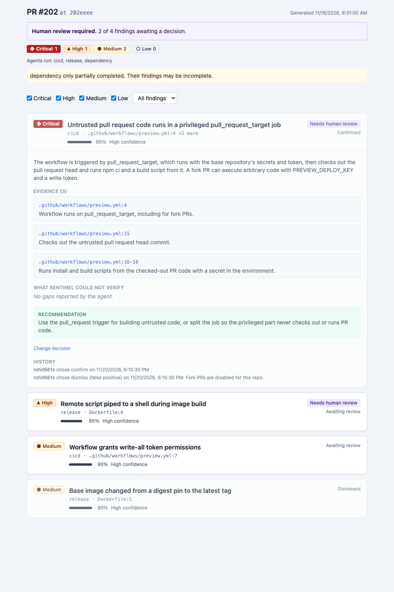

# Security Findings Dashboard (#6)

How Sentinel presents a `ReviewReport` to maintainers and how they act on
each finding. This is the Sprint 1 design. The dashboard is built out in
Sprint 4 ("Human review, dashboard and release risk"), and these components
are the starting point.

**Owners:** Sarthak + Rohit (#6). Data shapes come from the shared contracts
in [CONTRACTS.md](CONTRACTS.md) (#7).

| Deliverable | Location |
| --- | --- |
| Wireframe, presentation rules, review actions | This document |
| TypeScript mirrors of the #7 schemas | `frontend/src/types/findings.ts` |
| Proposed review-decision types | `frontend/src/types/review.ts` |
| Formatting helpers (no UI) | `frontend/src/lib/findings.ts` |
| Prototype components | `frontend/src/components/findings/` |

## Goals

A maintainer opening a review should be able to answer, in order:

1. **Do I need to look at this?** Whether review is required, and how many
   findings are still open.
2. **What is most important?** The findings ordered by severity, with
   confidence next to each one.
3. **Why does Sentinel think so?** The evidence, at the exact commit, plus
   what the agent could not verify.
4. **What do I do about it?** A recommendation, then confirm, dismiss or
   request investigation, with the reasoning recorded.

The design rules that follow from this:

- **Never hide a finding automatically.** Confidence and severity change how
  a finding is shown, never whether it is shown. Filters are the reviewer's
  choice and say how many findings they hide.
- **No findings is not the same as safe.** Empty and partial reports say
  which agents ran and which failed.
- **Severity and confidence are separate.** A critical finding with weak
  evidence still reads as critical, with low confidence beside it.
- **Agent output is untrusted text.** Titles, descriptions and observations
  are derived from PR content and are rendered as plain text, never HTML or
  Markdown.

## Wireframe

### Review page

```text
+--------------------------------------------------------------------------+
| PR #202 at 202eeee                         Generated 18 Nov 2026, 09:31  |
+--------------------------------------------------------------------------+
| [!] Human review required. 3 of 4 findings awaiting a decision.          |  <- report.requires_human_review
+--------------------------------------------------------------------------+
| [◆ Critical 1] [▲ High 1] [● Medium 2] [○ Low 0]                         |  <- severity counts
| Agents run: cicd, release, dependency                                    |  <- agents_run
| [⚠] dependency only partially completed. Their findings may be incomplete.|  <- agents_partial / agents_failed
+--------------------------------------------------------------------------+
| Filter: [x] Critical [x] High [x] Medium [x] Low   Show: [Unresolved v]  |
+--------------------------------------------------------------------------+
| [◆ Critical] Untrusted PR code runs in a privileged     [Needs human     |
|              pull_request_target job                      review]        |
|              cicd · .github/workflows/preview.yml:4 +2 more              |
|              ████████░ 95% High confidence        Awaiting review        |
+--------------------------------------------------------------------------+
| [▲ High]     Remote script piped to a shell during image build    ...    |
+--------------------------------------------------------------------------+
| [● Medium]   Workflow grants write-all token permissions          ...    |
+--------------------------------------------------------------------------+
```

### Expanded finding

```text
+--------------------------------------------------------------------------+
| [◆ Critical] Untrusted PR code runs in a privileged ...  [Needs human    |
|              cicd · .github/workflows/preview.yml:4 +2 more   review]    |
|              ████████░ 95% High confidence           Awaiting review     |
|--------------------------------------------------------------------------|
| The workflow is triggered by pull_request_target, which runs with the    |  <- description
| base repository's secrets ...                                            |
|                                                                          |
| EVIDENCE (3)                                                             |  <- evidence[], each a
|  .github/workflows/preview.yml:4      (links to the file at commit_sha)  |     link + observation
|  Workflow runs on pull_request_target, including for fork PRs.           |
|  .github/workflows/preview.yml:15                                        |
|  Checks out the untrusted pull request head commit.                      |
|  .github/workflows/preview.yml:16-18                                     |
|  Runs install and build scripts from the checked-out PR code ...         |
|                                                                          |
| WHAT SENTINEL COULD NOT VERIFY                                           |  <- uncertainty[]
|  - Did not check repository-level default token permissions.             |
|                                                                          |
| RECOMMENDATION                                                           |  <- recommendation
|  Use the pull_request trigger for building untrusted code, or ...        |
|                                                                          |
| [Confirm] [Request investigation] [Dismiss]                              |  <- review actions
|                                                                          |
| HISTORY                                                                  |
|  rohit661x chose dismiss (false positive) on 18 Nov 2026: Fork PRs ...   |
+--------------------------------------------------------------------------+
```

### Prototype

The components in `frontend/src/components/findings/` rendered with the
fixture findings from `evaluation/expected-findings/`. In this screenshot one
finding has been dismissed and then confirmed, so its history shows both
decisions:



## Presenting each field

| Field | Where | How |
| --- | --- | --- |
| `severity` | Card header, summary counts | Badge with text, colour **and** a shape marker (◆ ▲ ● ○), so it reads without colour. Findings are sorted critical → low, then by confidence. |
| `confidence` | Card header, under the location | Neutral grey meter plus the percentage and a band: **High** (≥ 0.80), **Moderate** (≥ 0.50), **Low** (< 0.50). The bands help reading only. They never filter, hide or re-rank findings. |
| `uncertainty` | Expanded card | "What Sentinel could not verify" list. An empty list reads "No gaps reported by the agent." It means the agent listed no gaps. It does not mean the finding is certain. |
| `evidence` | Card header (first location + count), expanded list | Each item shows `path:line` or `path:start-end` linked to `{repo_url}/blob/{commit_sha}/{path}#L{start}-L{end}`, so the link opens the code the agent reviewed, not the branch's current state. The observation is shown under it. |
| `recommendation` | Expanded card | Shown last before the actions, so the reviewer sees the evidence first. |
| `requires_human_review` | Card header badge | "Needs human review" badge. It follows the agent's explicit flag and is not derived from confidence. |
| `description` | Expanded card | Plain paragraph. |
| `agent` | Card header | Shown next to the location, for example `cicd · .github/workflows/preview.yml:4`. |
| `ReviewReport.requires_human_review` | Page banner | Violet banner with the number of findings still open. |
| `agents_run` / `agents_failed` / `agents_partial` | Summary | Lists the agents that ran. Failed and partial agents get an amber warning, because missing findings from them mean missing coverage. |
| `commit_sha` / `generated_at` | Page header | Short SHA and local time. |

`ReviewReport.severity_counts` is a Python property and is not in the API
response, so the frontend computes it with `severityCounts()`.

### Empty and degraded states

| Situation | What the page says |
| --- | --- |
| No findings, all agents succeeded | "No findings from the agents that ran (dependency, cicd). This is not a guarantee that the pull request is safe." |
| No agents ran (for example a docs-only PR) | "No agent covered the files in this pull request, so nothing was checked." |
| An agent failed | "release failed and reported no findings. Files they cover were not checked." |
| An agent partially completed | "dependency only partially completed. Their findings may be incomplete." |
| Filters hide everything | "No findings match these filters. N hidden." |

## Human review actions

Each finding has three actions. The reviewer's decision is recorded next to
the finding, and the agent's output is never edited.

| Action | Meaning | Required input | Resulting status |
| --- | --- | --- | --- |
| **Confirm** | The issue is real and should be fixed before merging. | Optional note | `confirmed` |
| **Dismiss** | No action is needed. | A reason **and** a note | `dismissed` |
| **Request investigation** | The reviewer can't decide yet and needs someone to look further, for example the PR author or a security owner. | A note saying what to check | `investigating` |

Dismiss reasons:

| Reason | Use when | Evaluation impact |
| --- | --- | --- |
| `false_positive` | The evidence doesn't show the claimed issue. | Candidate for a new **safe** fixture or a correction to an expected finding. |
| `accepted_risk` | The issue is real, but the team accepts it. | Counts as a true positive. It is not a false positive. |
| `not_applicable` | The issue is real in general but not in this repository's context. | Review case by case. It often means the agent is missing repository context (#4). |

### Status flow

```text
                 confirm
        +------------------------------> confirmed --+
        |                                            |
  open -+-- investigate --> investigating --+        | change decision
        |                                   |        | (records a new decision)
        +------------------------------> dismissed --+
                 dismiss          confirm / dismiss
```

- Every finding starts as `open`.
- `investigating` is unresolved. It stays in the default "Unresolved" view
  and can then be confirmed or dismissed.
- `confirmed` and `dismissed` are decisions. "Change decision" records a
  new decision. History is append-only, so earlier decisions are never
  overwritten.
- The page banner counts `open` findings. The default view shows `open`
  and `investigating`.

### Decision record (proposed)

There is no backend schema for decisions yet. `frontend/src/types/review.ts`
proposes this shape, to move into `backend/app/schemas/` (#7) when decisions
are persisted in Sprint 4:

```json
{
  "finding_key": "cicd::Workflow grants write-all token permissions::.github/workflows/preview.yml:7:",
  "commit_sha": "202eeeeeeeeeeeeeeeeeeeeeeeeeeeeeeeeeeeee",
  "action": "dismiss",
  "dismiss_reason": "accepted_risk",
  "note": "Preview job is being removed in #250.",
  "reviewer": "maintainer-a",
  "decided_at": "2026-11-18T15:02:00Z"
}
```

**Finding identity.** `SecurityFinding` has no `id`, so decisions are keyed
by `findingKey()`: the agent, the title and the sorted evidence locations.
This is the same rule `combine_findings()` uses to drop duplicates. It
breaks when a new commit shifts line numbers or an LLM rewords a title, so a
decision would not carry over to the next run. **Proposal for #7:** add a
stable `id` (or a `check_id` such as `CICD-001`, plus a location
fingerprint) to `SecurityFinding` before decisions are persisted.

**Commits.** Decisions record the `commit_sha` they were made against. When
a new commit produces the same finding key, the earlier decision is shown in
the history, marked as being for an earlier commit, and the finding starts
`open` again. The reviewer decides whether the earlier reasoning still
holds.

### Feeding evaluation

Reviewer decisions are the labelled data the evaluation harness needs.
`false_positive` dismissals and confirmed findings that the expected output
missed are the first candidates for new fixtures in `evaluation/` (see the
[evaluation README](../../evaluation/README.md)).

## Accessibility

- Severity is shown by text and shape as well as colour.
- The confidence meter uses `role="meter"` with a text value
  ("95%, high confidence").
- Cards expand from a real `<button>` with `aria-expanded`.
- Validation errors in the review form use `role="alert"`.
- Failed and partial agent warnings use `role="alert"`.

## Components

| Component | Responsibility |
| --- | --- |
| `FindingsList` | Page body: summary, filters, sorted cards. Holds filter and expand state only. |
| `ReportSummary` | Banner, severity counts, agents run and coverage warnings. |
| `FindingCard` | One finding: collapsed header, expanded details, history. |
| `SeverityBadge` | Severity label with colour and marker. |
| `ConfidenceIndicator` | Confidence meter, percentage and band. |
| `EvidenceList` | Evidence locations linked to the reviewed commit, with observations. |
| `UncertaintyList` | What the agent could not verify, with an explicit empty state. |
| `ReviewActions` | Confirm, dismiss and investigate, with client-side validation. |

Components receive data through props and call `onDecision` with a
validated `ReviewDecisionDraft`. Fetching and saving belong in the page under
`src/app/` and the API client in `src/lib/`.

The prototype was typechecked with `tsc --strict` and rendered in a browser,
but no Next.js app exists yet. When the app is initialized, the `@/*`
import alias should map to `./src/*` (the `create-next-app` default).

## Open questions

1. **Finding identity.** Should #7 add `id` or `check_id` to
   `SecurityFinding`? See above.
2. **Where decisions live.** In the backend database, or as GitHub PR review
   comments, or both? This decides whether the GitHub check status can depend
   on open findings.
3. **Merge gating.** Should any open `critical` finding, or any finding with
   `requires_human_review`, block a "Sentinel passed" check until it has a
   decision?
4. **Trace view.** PROJECT.md plans trace visualizations. A "How Sentinel
   reached this" tab on the expanded card is the natural place for them once
   tool-call traces exist.
