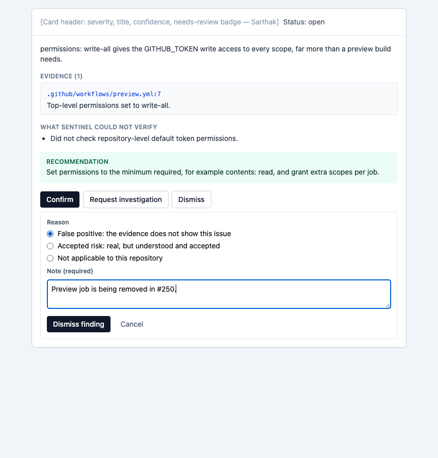
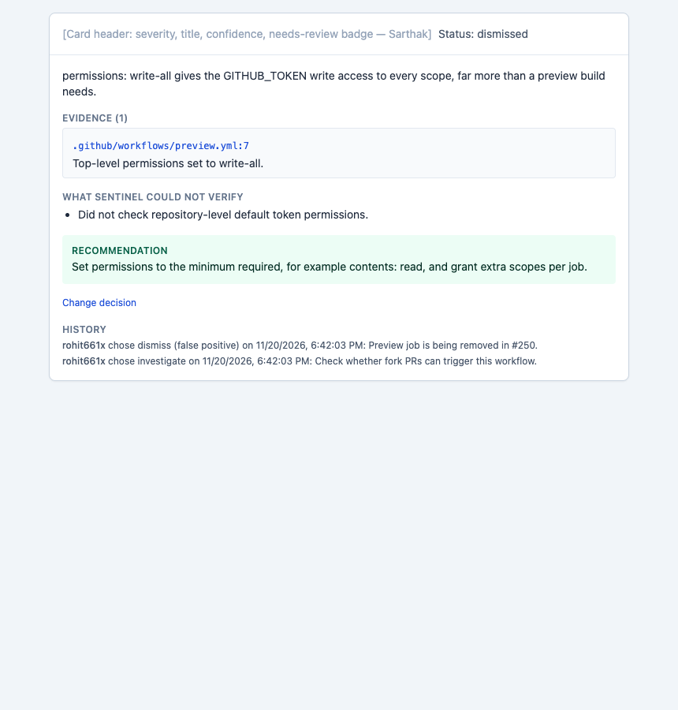

# Security Findings Dashboard (#6)

How Sentinel presents a `ReviewReport` to maintainers and how they act on
each finding. This is the Sprint 1 design. The dashboard is built out in
Sprint 4 ("Human review, dashboard and release risk").

**Owners:** Sarthak + Rohit (#6). Data shapes come from the shared contracts
in [CONTRACTS.md](CONTRACTS.md) (#7).

| Section | Owner |
| --- | --- |
| [Dashboard overview and findings list](#dashboard-overview-and-findings-list) | Sarthak |
| [Failed, partial and no-checks-run states](#failed-partial-and-no-checks-run-states) | Sarthak |
| [Severity, confidence and `requires_human_review`](#severity-confidence-and-requires_human_review) | Sarthak |
| [Expanded finding view](#expanded-finding-view) | Rohit |
| [Evidence, uncertainty and recommendation](#evidence-uncertainty-and-recommendation) | Rohit |
| [Human review actions](#human-review-actions) | Rohit |

| Code | Location |
| --- | --- |
| TypeScript mirrors of the #7 schemas | `frontend/src/types/findings.ts` |
| Proposed review-decision types | `frontend/src/types/review.ts` |
| Evidence and decision helpers | `frontend/src/lib/findings.ts` |
| Expanded view and review action components | `frontend/src/components/findings/` |

## Dashboard overview and findings list

> **TODO (Sarthak):** the review page overview and the collapsed findings
> list: page header, summary counts, sorting and filters.

## Failed, partial and no-checks-run states

> **TODO (Sarthak):** what the page shows when an agent failed
> (`agents_failed`), only partly completed (`agents_partial`), or no agent
> ran (`agents_run` is empty).

## Severity, confidence and `requires_human_review`

> **TODO (Sarthak):** how `severity`, `confidence` and
> `requires_human_review` are shown on the collapsed card and in the
> summary.

## Expanded finding view

Expanding a finding in the list shows the reasoning a reviewer needs before
acting. The sections run in a fixed order: what the claim is, the evidence
for it, what Sentinel could not verify, what to do about it, and then the
reviewer's decision. The reviewer always reads the evidence before the
recommendation or the action buttons.

```text
+--------------------------------------------------------------------------+
| [collapsed card header: severity, title, location, confidence,           |  <- findings list
|  needs-review badge, review status]                                      |     (Sarthak)
|--------------------------------------------------------------------------|
| The workflow is triggered by pull_request_target, which runs with the    |  <- description
| base repository's secrets and token, then checks out the pull request    |
| head and runs npm ci and a build script from it. ...                     |
|                                                                          |
| EVIDENCE (3)                                                             |  <- evidence[]
|  .github/workflows/preview.yml:4          (link to the file at commit)   |
|  Workflow runs on pull_request_target, including for fork PRs.           |
|  .github/workflows/preview.yml:15                                        |
|  Checks out the untrusted pull request head commit.                      |
|  .github/workflows/preview.yml:16-18                                     |
|  Runs install and build scripts from the checked-out PR code ...         |
|                                                                          |
| WHAT SENTINEL COULD NOT VERIFY                                           |  <- uncertainty[]
|  - Did not check repository-level default token permissions.             |
|                                                                          |
| RECOMMENDATION                                                           |  <- recommendation
|  Use the pull_request trigger for building untrusted code, or split ...  |
|                                                                          |
| [Confirm] [Request investigation] [Dismiss]                              |  <- review actions
|  +--------------------------------------------------------------------+  |
|  | Reason  (o) False positive  ( ) Accepted risk  ( ) Not applicable   |  |  <- shown for Dismiss
|  | Note (required) [_______________________________________________]   |  |
|  | [Dismiss finding]  Cancel                                           |  |
|  +--------------------------------------------------------------------+  |
|                                                                          |
| HISTORY                                                                  |  <- decisions, newest first
|  rohit661x chose dismiss (false positive) on 18 Nov 2026: Preview job... |
|  rohit661x chose investigate on 18 Nov 2026: Check whether fork PRs ...  |
+--------------------------------------------------------------------------+
```

### Prototype

`FindingDetails` rendered with the medium-severity finding from
`evaluation/expected-findings/cicd-pull-request-target-head-checkout.json`.
The grey header line stands in for the collapsed card header.

| Dismiss form open | After investigate, then dismiss |
| --- | --- |
|  |  |

## Evidence, uncertainty and recommendation

| Field | How it is shown |
| --- | --- |
| `evidence[].file_path`, `line_start`, `line_end` | `path:line`, or `path:start-end` for a range. Each one links to `{repo_url}/blob/{commit_sha}/{path}#L{start}-L{end}`, so the link opens the code the agent reviewed, not the branch's latest state. The heading shows the count, for example "Evidence (3)". |
| `evidence[].observation` | Shown under its location. Each evidence item is its own block, in the order the agent gave them. |
| `uncertainty` | Listed under "What Sentinel could not verify". An empty list reads "No gaps reported by the agent." It means the agent listed no gaps. It does not mean the finding is certain. |
| `recommendation` | A highlighted block after the evidence and uncertainty, right before the actions. |
| `description` | A plain paragraph at the top of the expanded view. |

All of these come from agent output, which is derived from untrusted pull
request content. They are rendered as plain text, never as HTML or
Markdown.

## Human review actions

Each finding has three actions. The reviewer's decision is recorded next to
the finding. The agent's output is never edited.

| Action | Meaning | Required input | Resulting status |
| --- | --- | --- | --- |
| **Confirm** | The issue is real and should be fixed before merging. | Optional note | `confirmed` |
| **Dismiss** | No action is needed. | A reason **and** a note | `dismissed` |
| **Request investigation** | The reviewer can't decide yet and needs someone to look further, for example the PR author or a security owner. | A note saying what to check | `investigating` |

Dismiss reasons:

| Reason | Use when | Evaluation impact |
| --- | --- | --- |
| `false_positive` | The evidence doesn't show the claimed issue. | Candidate for a new **safe** fixture or a correction to an expected finding. |
| `accepted_risk` | The issue is real, but the team accepts it. | Still a true positive. It is not a false positive. |
| `not_applicable` | The issue is real in general but not in this repository's context. | Review case by case. It often means the agent is missing repository context (#4). |

### Status flow

```text
                 confirm
        +------------------------------> confirmed --+
        |                                            |
  open -+-- investigate --> investigating --+        | change decision
        |                                   |        | (records a new decision)
        +------------------------------> dismissed --+
                 dismiss          confirm / dismiss
```

- Every finding starts as `open`.
- `investigating` is unresolved. From there the reviewer can confirm or
  dismiss. "Request investigation" isn't offered again.
- `confirmed` and `dismissed` are decisions. The actions are replaced by
  "Change decision", which records a new decision. History is append-only,
  so earlier decisions are never overwritten.
- Switching between Dismiss and Request investigation clears the form, so a
  note written for one action is never submitted as the other.

### Decision record (proposed)

There is no backend schema for decisions yet. `frontend/src/types/review.ts`
proposes this shape, to move into `backend/app/schemas/` (#7) when decisions
are persisted in Sprint 4:

```json
{
  "finding_key": "cicd::Workflow grants write-all token permissions::.github/workflows/preview.yml:7:",
  "commit_sha": "202eeeeeeeeeeeeeeeeeeeeeeeeeeeeeeeeeeeee",
  "action": "dismiss",
  "dismiss_reason": "accepted_risk",
  "note": "Preview job is being removed in #250.",
  "reviewer": "maintainer-a",
  "decided_at": "2026-11-18T15:02:00Z"
}
```

The component submits a `ReviewDecisionDraft` (`finding_key`, `action`,
`dismiss_reason`, `note`). The server adds `reviewer`, `commit_sha` and
`decided_at`.

**Finding identity.** `SecurityFinding` has no `id`, so decisions are keyed
by `findingKey()`: the agent, the title and the sorted evidence locations.
This is the same rule `combine_findings()` uses to drop duplicates. The key
changes when a new commit shifts line numbers or an LLM rewords a title, so
a decision would not carry over to the next run. **Proposal for #7:** add a
stable `id` (or a `check_id` such as `CICD-001`, plus a location
fingerprint) to `SecurityFinding` before decisions are persisted.

**Commits.** Each decision records the `commit_sha` it was made against.
Decisions from an earlier commit are labelled in the history ("for an
earlier commit abc1234"). The reviewer then decides whether the earlier
reasoning still holds.

### Feeding evaluation

Reviewer decisions are labelled data for the evaluation harness. Findings
dismissed as `false_positive`, and confirmed findings that the expected
output missed, are the first candidates for new fixtures in `evaluation/`
(see the [evaluation README](../../evaluation/README.md)).

### Accessibility

- Review actions are a labelled button group, and the selected action has
  `aria-pressed`.
- Dismiss reasons are a `fieldset` of radio buttons with a legend.
- Validation errors use `role="alert"`.
- Evidence links open in a new tab with `rel="noreferrer noopener"`.

## Open questions

1. **Finding identity.** Should #7 add `id` or `check_id` to
   `SecurityFinding`? See above.
2. **Where decisions live.** In the backend database, or as GitHub PR review
   comments, or both? This decides whether the GitHub check status can depend
   on open findings.
3. **Merge gating.** Should a finding that is still `open` or
   `investigating` block a "Sentinel passed" check?
